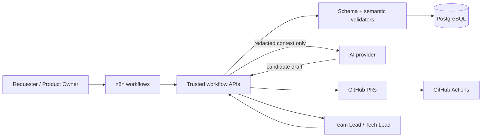

# DESIGN.md — WF-01–WF-04 Orchestration System

**Status:** Proposed target design  
**Repository:** `muchlisbstg/business-automation-system`  
**Related architecture:** [WF-01–WF-04 Orchestration Architecture](docs/architecture/wf-01-04-orchestration-architecture.md)  
**Scope:** Intake, requirement/backlog planning, deterministic sprint planning, and architecture decision records.

> This document describes intended behavior. It does not imply every target component is implemented. Check the source, contracts, migrations, workflow exports, and CI evidence before reporting implementation status.

## 1. Design principles

1. **n8n orchestrates; it is not the policy authority.** Trusted application services and the database enforce authorization, schema/state invariants, and persistence rules.
2. **Contract first.** Version schemas, enums, status transitions, task keys, priority/complexity/effort rubrics, and Definition of Done templates before changing workflow behavior.
3. **AI proposes; deterministic code validates.** AI-generated content is untrusted until it passes schema and semantic checks.
4. **Human approval is explicit and authenticated.** An AI response, caller-supplied role, or `approved=true` field is not authorization evidence.
5. **Fail closed.** Missing input, source, approval, validation evidence, or unknown state blocks downstream side effects.
6. **Idempotent by design.** Replays must not duplicate requirements, tasks, decisions, approvals, or sprint assignments.
7. **Least privilege.** n8n must not run DDL/migrations or hold broad production database privileges.
8. **Auditable changes.** Persist actor, reason, correlation ID, source/version references, and before/after state references without secrets.
9. **No silent scope loss.** Uncovered requirements and removed/obsolete items are explicitly reported.
10. **No autonomous production action.** Merge, deployment, destructive operations, and production activation require the repository's authorized human gates.

## 2. Logical components

This is the target logical model. Verify each integration against actual code/configuration before treating it as deployed.

## 3. Workflow design

### WF-01 — Project Intake

**Input:** form, webhook, or manual project request.

**Flow:**
1. Validate request against the canonical brief schema and configured enums.
2. Detect missing or ambiguous required values.
3. If clarification is required, return concrete questions (target maximum 5–7), set `NEEDS_CLARIFICATION`, and do not create a final brief from guesses.
4. Mark values as supplied, inferred, or unknown; inferred values need requester confirmation.
5. Redact sensitive fields before any model request.
6. Persist a versioned draft with input fingerprint and audit metadata.
7. Require authenticated Product Owner approval before WF-02 can create/update planning data.

**Invariant:** WF-02 independently checks persisted approval/version at its trusted boundary; it must not trust a caller-provided approval boolean.

### WF-02 — Requirement → Backlog

**Input:** approved brief and a versioned PRD.

**Flow:**
1. Normalize and version requirements (`REQ-...`) with source references.
2. Generate candidate Epic/Feature/Story/Task, bug, or technical-debt items.
3. Validate the output against schema, then run deterministic semantic validation.
4. Require measurable acceptance criteria and measurable DoD.
5. Reject vague titles, missing dependencies, nonexistent dependency targets, cycles, and tasks above the configured effort ceiling unless split.
6. Verify every requirement has one or more linked tasks or appears in an explicit coverage-gap report.
7. Use stable task keys and fingerprints; reruns should update only affected items and provide a diff.
8. Preserve removed items as review candidates; do not silently delete records.
9. Route invalid output to human review after one bounded correction retry.

**Invariant:** no AI-produced task is automatically `READY`; Definition of Ready must be independently satisfied.

### WF-03 — Sprint Planner

**Input:** eligible `READY` tasks, dependencies, priority/risk metadata, team capacity, leave/on-call, and sprint configuration.

**Planning rules:**
- Calculate individual capacity from working availability, configured focus factor, leave, and on-call.
- Reserve the configured planning buffer (target default 20%) before selecting work.
- Sort deterministically using documented priority/risk rules and stable tie-breakers.
- Respect dependency order, skill constraints, high-risk limits, and capacity.
- Report selected and excluded tasks, load per person, critical path, and at-risk work.
- Use median velocity from recent completed sprints only as a team forecast; never use it to rank individual performance.
- Keep `sprint_id` unset until Team Lead confirmation.
- Require a scope-change request, impact analysis, approval, and audit for mid-sprint additions.

**Invariant:** identical snapshots + configuration + contract versions produce identical selected tasks and assignments. AI may explain trade-offs but cannot change the plan.

### WF-04 — Architecture Design / ADR

**Current evidence:** the repository contains a WF-04 ADR schema/proposal. Do not assume a complete runtime exists until verified.

**Trigger:** major architecture-impact change or authorized manual request.

**Required design content:**
- Fixed architecture template with every mandatory section populated.
- Context, goals/non-goals, current/proposed architecture, data architecture, API/integration, security, NFR, operations/reliability, bottlenecks/SPOF, costs/assumptions, and alternatives/trade-offs.
- STRIDE threat analysis and explicit data consistency risks.
- Measurable SLO, p95/p99 where applicable, throughput, RPO/RTO, and recovery targets. Unknown targets must remain explicitly undefined and require a decision.
- At least two alternatives with meaningful trade-offs.
- Mermaid diagram, draft OpenAPI, draft DDL, risk register, and source references.
- Cross-artifact consistency checks before a documentation-only PR is created.

**ADR lifecycle:** use the canonical status vocabulary already defined by the current schema unless a reviewed contract migration changes it consistently. The existing WF-04 schema uses a `DRAFT` status for draft payloads; do not casually mix it with `PROPOSED` in other layers.

**Invariant:** architecture-dependent technical tasks remain blocked until an authenticated Tech Lead accepts the ADR. Accepted ADR content is immutable; changes require a new superseding ADR. DDL remains a non-executable proposal.

## 4. Shared contracts

Before adding a new schema or changing a contract, inventory existing files and choose one canonical source. Avoid duplicated contracts that drift.

Required contract areas:
- Brief and project approval.
- Requirement and task.
- Priority, complexity (1–5), effort, and task-key format.
- DoD templates for frontend, backend, database, and mobile.
- Task state transitions.
- Sprint planning input/output and scope changes.
- Architecture design, ADR, risks, OpenAPI draft, and DDL draft.
- Human review/approval events.
- Audit and correlation metadata.

Every AI step must pass schema validation and deterministic semantic validation before persistence or downstream use. If output fails, allow one correction attempt; after a second failure, route to human review and do not store the invalid output as final.

## 5. State and approval boundaries

- Brief: incomplete/ambiguous → `NEEDS_CLARIFICATION`; draft → pending approval → approved or rejected.
- Backlog tasks: transitions must be checked against the canonical `allowed_transitions` table. Examples such as `BACKLOG → DONE` or `READY → QA` must be rejected unless explicitly allowed by the approved contract.
- Sprint: plan draft → pending Team Lead confirmation → confirmed/active; no assignment before confirmation.
- ADR: use one canonical lifecycle across schema, API, database, and docs; approval is authenticated and version-bound.
- Scope change: no mid-sprint addition without explicit approval.
- Production: CI/CD and destructive actions remain separate gates with evidence tied to an immutable commit SHA.

The database or trusted service must enforce transitions and authorization. Hiding buttons or checking values only in n8n is not sufficient.

## 6. Security and data handling

- Treat PRD text, issue descriptions, uploaded documents, external API responses, and AI outputs as untrusted data.
- Prompt injection in user content must never alter policy, status, permissions, or tool routing.
- Redact secrets, credentials, tokens, passwords, and unnecessary sensitive data before model calls.
- Audit redaction using metadata and payload hashes; never log raw secret values.
- Use authenticated identity from a trusted identity provider. Do not accept a reviewer identity or role from untrusted request content.
- Use least-privilege service/database roles. The n8n application role must not have DDL, role-management, or grant privileges.
- Run migrations only through the controlled CI/CD path using a dedicated migration identity.
- Keep audit history append-only for the workflow role.
- Use synthetic data and disposable databases for tests involving migrations or cross-tenant/security boundaries.

## 7. Reliability and consistency

- Propagate `correlation_id` across workflow execution, API, persistence, AI calls, GitHub artifacts, and audit.
- Use stable idempotency keys and normalized input hashes.
- Reject reuse of an idempotency key with conflicting input.
- Use bounded retries with backoff for transient failures; do not retry authorization errors indefinitely.
- Use transactional state updates and audit records, or a documented outbox/compensating-event approach when crossing systems.
- Make downstream events replay-safe.
- Surface exhausted retries in a human-review/dead-letter queue.
- Do not report a downstream operation successful without persisted evidence.

## 8. Repository and CI expectations

The inspected repository includes Node.js >=22 package definitions for WF-01–WF-03 with TypeScript test/typecheck scripts and PostgreSQL migration scripts, plus a GitHub Actions CI workflow. Use the actual package scripts and CI definitions; do not invent commands or claim a check ran without its result.

For a change:
1. Identify the affected workflow/package and canonical contracts.
2. Add/update focused unit and contract tests.
3. Add integration tests for persistence, authorization, state transitions, idempotency, and cross-workflow boundaries where applicable.
4. Run the relevant package test/typecheck scripts and repository CI checks.
5. Verify schema/migration compatibility against a disposable database when applicable.
6. Review secrets, permissions, and audit impact.
7. Tie evidence to the exact commit SHA.
8. Leave merge/deployment decisions to authorized humans.

## 9. Required acceptance scenarios

- Missing intake fields lead to concrete clarification questions, not guessed brief content.
- Unapproved brief cannot trigger WF-02, even through direct/manual invocation.
- Prompt-injection content cannot mutate state or policy.
- Every requirement maps to tasks or an explicit coverage-gap report.
- Vague tasks, over-limit effort, missing dependencies, and cycles are rejected.
- Reruns are idempotent; a single requirement edit produces a scoped diff.
- Sprint workload remains within effective capacity after buffer; dependencies and deterministic ordering are preserved.
- Invalid status transitions are rejected at the trusted/database boundary and audited with correlation ID.
- Unapproved mid-sprint scope additions are blocked.
- Missing architecture sections, cost assumptions, risk analysis, or alternatives fail validation.
- No architecture-dependent task is created before ADR acceptance.
- Accepted ADR content cannot be edited in place.
- The n8n production role cannot execute DDL.
- Sensitive data is redacted before LLM invocation, with auditable evidence.
- No merge, deployment, or production mutation occurs without explicit authorization.

## 10. Change checklist

Before implementation:
- [ ] Check existing schemas and paths; avoid duplicate sources of truth.
- [ ] Identify current vs proposed behavior in documentation.
- [ ] Define migration/backward-compatibility impact.
- [ ] Add deterministic tests for both allowed and rejected paths.
- [ ] Verify actor authorization and database privileges.
- [ ] Add correlation/audit evidence without sensitive values.
- [ ] Confirm rollback/recovery plan for stateful changes.
- [ ] Keep merge, deployment, and production activation behind human gates.
