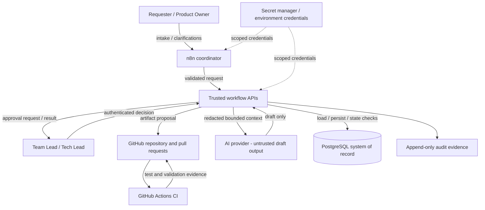
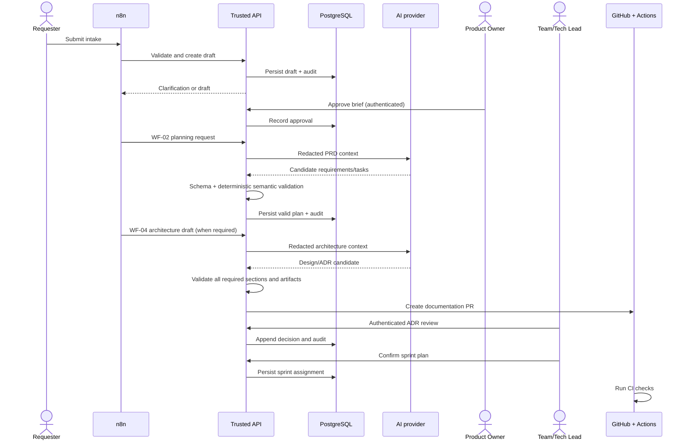

# WF-01–WF-04 Orchestration Architecture

**Status:** Architecture proposal for review  
**Repository:** `muchlisbstg/business-automation-system`  
**Scope:** Project intake, requirement/backlog planning, sprint orchestration, and architecture decision governance  
**Evidence baseline:** Repository `main` inspected on 2026-10-27. This document describes verified repository facts separately from proposed target behavior.  
**Change control:** Documentation-only proposal. It does not authorize merge, deployment, database migration, production workflow activation, or DDL execution.

## 1. Executive summary

The target design uses n8n as a workflow coordinator, application services as the trusted enforcement and persistence boundary, PostgreSQL as the durable system of record, GitHub/GitHub Actions for versioned artifacts and deterministic CI, and AI only for bounded draft/recommendation work.

The architecture must fail closed when required inputs, evidence, approvals, schemas, or state transitions are missing. Approval is an explicit, authenticated human action—not an AI-generated field, webhook claim, or workflow parameter.

## 2. Evidence and implementation status

### Verified in the repository

- `docs/architecture.md` states that n8n is the orchestration layer, GitHub Actions/cloud infrastructure execute deterministic CI/CD work, AI cannot autonomously approve high-impact actions, and executions should carry correlation IDs and audit records.
- `docs/security.md` states that `n8n_app` must not update/delete audit history and n8n workflows must not execute schema-changing DDL; migrations belong in CI/CD.
- `workflows/README.md` documents the workflow catalogue and explicitly distinguishes implemented bridges from proposal-only contracts.
- `api/wf-01-intake/package.json`, `api/wf-02-planning/package.json`, and `api/wf-03-orchestration/package.json` define Node.js >=22, TypeScript test/typecheck scripts, and PostgreSQL migration scripts.
- `.github/workflows/ci.yml` includes repository/JSON/contract validation and a PostgreSQL-backed `wf-03-orchestration` job that installs WF-01 and WF-02 dependencies for cross-workflow tests.
- `workflows/WF-04-adr/README.md` and `workflows/WF-04-adr/schema.json` define WF-04 as a **proposal/contract candidate**. The schema includes `CREATE_DRAFT`, `SUBMIT_FOR_REVIEW`, and `RECORD_REVIEW`; its presence does not prove a complete WF-04 runtime exists.
- `workflows/WF-02-03-review-signal/README.md` describes a human-review signal bridge and explicitly notes that the caller remains trusted; the bridge itself does not authenticate a source or grant approval.

### Not established by this evidence

This document does not claim that all n8n exports are present, all workflows are connected to live credentials, all human identities are independently authenticated, all state transitions are protected by database constraints, or WF-04 runtime/persistence is implemented. Those items require code, configuration, CI, and runtime evidence.

## 3. Goals and non-goals

### Goals

1. Keep input, planning, sprint, and architecture decisions traceable end-to-end.
2. Enforce schema and semantic validation before data is persisted or handed downstream.
3. Make reruns idempotent and changes narrowly scoped.
4. Require authorized human approval for brief, backlog, sprint, and architecture decisions at their defined gates.
5. Prevent prompt injection or untrusted document content from changing workflow policy or state.
6. Keep database migrations, build/test, and deployment outside n8n.
7. Preserve audit evidence without logging secrets or unnecessary sensitive data.

### Non-goals

- Automatically merging pull requests or deploying production.
- Executing DDL or migrations from n8n.
- Letting AI decide approvals, directly mutate status, or override validators.
- Treating a proposal, schema, diagram, or passing unit test as proof of production readiness.
- Replacing domain authorization with n8n node-level conditions alone.

## 4. Logical architecture

The diagram is a target design, not a claim that every connection currently exists. The API and database must enforce authorization and invariants even if a caller bypasses n8n.

## 5. Workflow responsibilities and gates

### WF-01 — Project Intake

**Input:** form, webhook, or manual request.

**Required behavior:**
- Validate required fields, types, enums, and bounds against a versioned brief contract.
- If required information is missing or ambiguous, return concrete clarification questions and set `NEEDS_CLARIFICATION`; do not create a guessed final brief.
- Mark fields as `given`, `inferred`, or `unknown`; inferred values require confirmation.
- Redact sensitive data before any AI call.
- Persist a versioned draft with a stable idempotency/fingerprint key.
- Require an authenticated Product Owner approval before WF-02 may plan the brief.

**Hard gate:** an unapproved brief cannot create or update WF-02 planning records, even if a caller manually invokes the endpoint.

### WF-02 — Requirement and Backlog Planning

**Input:** approved brief and PRD version.

**Required behavior:**
- Convert the PRD into versioned requirements and traceable epics/features/stories/tasks.
- Validate AI output with JSON Schema and deterministic semantic checks.
- Require measurable acceptance criteria and measurable Definition of Done.
- Reject vague task titles, tasks over the configured 16-hour limit unless split, missing dependencies, and dependency cycles.
- Ensure each requirement maps to at least one task or appears in an explicit `requirements_without_tasks` report.
- Use stable task keys and fingerprints; reruns update only affected records and produce a diff.
- Preserve removed items as candidates for review rather than silently deleting history.
- AI estimates remain estimates until accepted/calibrated by the team.

**Hard gate:** invalid output is not stored as a valid backlog. After one correction retry, route failures to human review.

### WF-03 — Deterministic Sprint Planner

**Input:** validated `READY` tasks, dependencies, team availability, leave/on-call, focus factor, risk policy, and sprint configuration.

**Required behavior:**
- Compute effective capacity deterministically.
- Apply a configurable buffer (target default 20%) before selecting work.
- Respect dependency ordering, priority/risk rules, high-risk limits, and per-person capacity.
- Report selected/excluded tasks, per-person load, critical path, and at-risk items.
- Use historical velocity only as a team forecast; never as an individual performance score.
- Keep `sprint_id` unset until Team Lead confirmation.
- Require a scoped change request and approval for mid-sprint additions.
- Produce identical deterministic plan results for identical input snapshots and configuration.

**Hard gate:** database/state-transition rules reject invalid transitions; n8n-only validation is insufficient.

### WF-04 — Architecture Design and ADR

**Current repository status:** contract/proposal evidence exists; a complete runtime is not established by the inspected files.

**Target behavior:**
- Trigger for major architectural changes (new service/datastore, auth/permission changes, external integration, significant schema change, scale threshold, or high security requirement) or an authorized manual request.
- Read approved brief/requirements and relevant architecture sources; identify facts, assumptions, and unknowns separately.
- Produce a fixed architecture template, Mermaid diagram, draft OpenAPI, draft DDL, NFR targets, bottleneck/SPOF analysis, consistency risks, STRIDE threats, cost assumptions, and at least two alternatives with trade-offs.
- Reject missing mandatory sections and inconsistent cross-artifact references.
- Open a reviewable PR containing documentation artifacts only.
- Keep ADR proposed until authenticated Tech Lead review.
- Make accepted ADR content immutable; architecture changes require a new ADR that supersedes the prior one.
- Propagate measurable NFR targets into technical-task acceptance criteria after acceptance.

**Hard gate:** no architecture-dependent technical task is created before ADR acceptance. Acceptance does not authorize execution, merge, deployment, or database migration.

## 6. Cross-workflow sequence

This sequence describes desired integration behavior. Each arrow must be verified against implementation before being described as operational.

## 7. Trust boundaries and security controls

### Untrusted inputs

Treat PRDs, issue bodies, form text, imported documents, Figma text, external API responses, and AI output as data—not executable instructions.

Controls:
- Never let input text modify system prompts, authorization policy, approval state, allowed transitions, or tool permissions.
- Redact secrets and unnecessary sensitive fields before model invocation.
- Bound payload size, field length, source count, retries, and execution time.
- Validate output using schemas plus deterministic semantic validators.
- Never trust a caller-supplied `approved=true`, role, reviewer identity, environment, or target as proof of authorization.

### Authorization

- Authenticate the human reviewer outside the model and outside caller-controlled JSON.
- Authorize by project/repository scope and role on the trusted service.
- Enforce separation of duties where required; the requester must not self-approve restricted decisions.
- Treat n8n as a service identity with least privilege, not a superuser.
- Reject missing/unknown approval evidence (fail closed).

### Database privilege boundary

- The n8n application role must not have schema-changing privileges.
- Do not grant `CREATE`, `ALTER`, `DROP`, `TRUNCATE`, role-management, or grant privileges to the workflow role.
- n8n may invoke approved application operations; migrations execute only through the controlled CI/CD migration path.
- Audit history must be append-only to the application role; corrections are compensating events, not silent edits.
- Verify the actual production grants through database privilege tests; this document alone does not prove the grants are configured.

## 8. Data model and contracts

The following is the target logical model. It does not assert that every table currently exists under these names.

| Entity | Purpose | Key invariants |
|---|---|---|
| `projects` / `brief_versions` | Project intake and version history | Draft and approved versions are distinct; approval is attributable. |
| `requirements` | Versioned PRD-derived requirements | Every requirement is traceable to a source/version. |
| `tasks` | Backlog and task state | Stable task key; valid transition only; measurable AC/DoD. |
| `task_dependencies` | Directed dependency graph | Both tasks exist; cycles are rejected before readiness/planning. |
| `sprints` / `sprint_assignments` | Sprint plans and task membership | Capacity is respected; assignment requires confirmation. |
| `architecture_runs` / `architecture_artifacts` | Design input snapshot and generated draft references | Source versions and artifact hashes are retained. |
| `adrs` / `adr_reviews` | Architecture decision lifecycle | Review is authenticated; accepted version is immutable. |
| `approvals` | Human decisions | Decision is bound to subject, version, scope, actor, and evidence. |
| `audit_logs` | Append-only event history | Correlation ID, actor, action, timestamp, reason, before/after references. |
| `outbox` / `dead_letter` | Reliable event handoff and failure recovery | Idempotent delivery; bounded retries; explicit recovery. |

### Contract files

Keep canonical JSON Schemas, enums, transition tables, and rubrics version-controlled. Suggested target paths (create only after checking existing contracts to avoid duplication):

- `workflows/WF-01-intake/schema.json`
- `workflows/WF-02-planning/schema.json`
- `workflows/WF-03-orchestration/schema.json`
- `workflows/WF-04-adr/schema.json`
- shared definitions for priority, complexity, effort, DoD templates, task-key format, and allowed status transitions.

Repository evidence currently shows a WF-04 schema at `workflows/WF-04-adr/schema.json` and API package paths for WF-01–WF-03. Reconcile naming and reuse existing canonical contracts before introducing new files.

## 9. State machines

### Brief

`DRAFT → NEEDS_CLARIFICATION | PENDING_APPROVAL → BRIEF_APPROVED | REJECTED`

Only an authorized Product Owner can approve. A rejected or incomplete brief cannot trigger WF-02.

### Task

Use the repository's canonical `allowed_transitions` table as the only permitted transition source. Reject transitions such as `BACKLOG → DONE` or `READY → QA` when absent from that table. Do not duplicate transition logic in multiple inconsistent locations.

### Sprint

`DRAFT_PLAN → PENDING_TEAM_CONFIRMATION → CONFIRMED → ACTIVE → COMPLETED`

A plan is not assigned to a sprint until confirmation. Mid-sprint scope changes require a separate request, impact analysis, approval, and audit event.

### ADR

The existing WF-04 proposal describes `DRAFT → PENDING_REVIEW → ACCEPTED | REJECTED`. Use this lifecycle unless a reviewed contract change deliberately adopts the alternative `PROPOSED` label. Do not mix the two status vocabularies across API, schema, database, and docs.

Once accepted, the ADR version is immutable. A new ADR may supersede it; the old record remains available for audit.

## 10. Idempotency, retries, and audit

- Assign a `correlation_id` at the trusted ingress and propagate it through API calls, model requests, persistence, GitHub artifacts, and error handling.
- Use a deterministic idempotency key for each logical operation; store normalized input hash and contract version.
- Identical replays return the existing result and must not duplicate tasks, approvals, transitions, or audit decisions.
- Same key with conflicting content returns a conflict; never silently overwrite an accepted decision.
- Retry transient errors with bounded exponential backoff and jitter. Do not retry authorization failures or schema-invalid payloads indefinitely.
- AI output may receive one correction retry. If it still fails validation, route to human review and do not store it as a valid final artifact.
- Keep secrets out of audit records. Store redaction evidence and payload hashes rather than raw sensitive values.
- Use an outbox or equivalent atomic event handoff where a database commit and downstream event must not diverge.

## 11. CI/CD and artifact governance

Target flow:

1. Pull request changes source, contracts, migrations, or workflow exports.
2. GitHub Actions runs JSON/schema validation, type checks, unit tests, integration/contract tests, and security checks applicable to the changed area.
3. Database migrations are reviewed and run only by a dedicated migration identity in the controlled delivery path.
4. Merge remains a human/repository-governance decision; no AI output or n8n signal may merge on its own.
5. Deployment requires explicit human approval and environment-scoped credentials.
6. Verify the exact commit SHA and post-deployment health before reporting success.

For this architecture-document PR, only documentation is being proposed. It does not change CI configuration, execute migrations, activate workflows, or deploy services.

## 12. Observability and operations

Every execution should expose structured fields such as:

- `correlation_id`, `workflow_id`, `workflow_version`, `run_id`;
- `project_id`, `request_id`, `plan_id`, `adr_id` when applicable;
- `contract_version`, `input_hash`, `source_versions`;
- `actor_id`, `decision`, `status_before`, `status_after`;
- `retry_count`, `error_code`, `duration_ms`, `evidence_refs`.

Monitor validation failures, approval latency, duplicate replays, dead-letter depth, retry exhaustion, database permission denials, and stuck pending-review records. Alert thresholds and retention values must be explicitly configured and verified; do not invent them in documentation.

## 13. Failure handling

| Failure | Required response |
|---|---|
| Missing or ambiguous intake data | Ask clarifying questions; do not create a guessed approved brief. |
| Brief not approved | Block WF-02 at the trusted API boundary. |
| Schema or semantic validation failure | Reject candidate; one bounded correction attempt, then human-review queue. |
| Prompt-injection text in PRD | Treat as untrusted content; no workflow/state/permission changes. |
| Missing requirement coverage | Emit explicit gap report; do not silently drop the requirement. |
| Dependency cycle | Reject readiness/planning and report the cycle path. |
| Capacity exceeded | Exclude work; never overbook the confirmed capacity budget. |
| Invalid state transition | Reject atomically and record a security/audit event. |
| Missing ADR approval | Block architecture-dependent task creation. |
| Accepted ADR mutation | Reject; require a new superseding ADR. |
| DDL attempt from n8n | Database privilege boundary rejects it. |
| AI timeout/invalid output | Fail closed; preserve error metadata, not invalid final output. |
| GitHub/DB downstream timeout | Use idempotent retry/outbox and reconciliation; do not claim success without evidence. |

## 14. Acceptance criteria

### WF-01
- Empty required fields produce concrete clarification questions, not a final brief.
- Unapproved brief cannot trigger WF-02 through any public/manual caller path.
- Sensitive data is redacted before the model call; audit evidence contains no raw secret.
- Approval is tied to an authenticated actor and a specific brief version.

### WF-02
- Prompt-injection text cannot change task state or policy.
- Every requirement has at least one task or appears in a gap report.
- Vague tasks are rejected; tasks above 16 hours are rejected or split.
- Missing dependencies and dependency cycles are detected.
- Identical reruns do not duplicate tasks; a single-requirement change produces a scoped diff.

### WF-03
- Selected workload never exceeds effective capacity minus the configured buffer.
- Dependencies are respected and the plan is deterministic for identical snapshots.
- Sprint assignment waits for Team Lead confirmation.
- Mid-sprint additions without approval are blocked.
- Invalid database transitions are rejected; valid transitions include `correlation_id` and audit evidence.

### WF-04
- Any missing mandatory architecture section, risk section, NFR target, or required alternative fails validation.
- Draft Mermaid/OpenAPI/DDL cross-reference the same architecture model.
- DDL is never executed by n8n; production role grants are independently tested.
- Technical tasks requiring architecture approval remain blocked until an authenticated Tech Lead accepts the ADR.
- Accepted ADR versions cannot be edited; superseding changes create a new version/ADR.
- WF-04 status remains accurately marked proposal until runtime and integration evidence is verified.

### Cross-cutting
- Schema and semantic validation run before persistence or downstream state changes.
- Approval, task transitions, and audit events are atomic or use a documented equivalent consistency mechanism.
- CI evidence is tied to the exact commit SHA.
- No merge, deployment, or production mutation occurs as a side effect of this design.

## 15. Phased implementation plan

### Phase 0 — Contract inventory
- Compare existing schemas, API request/response contracts, database migrations, and workflow exports.
- Resolve duplicate naming and status vocabularies.
- Record each component as implemented, tested, proposed, or not verified.

### Phase 1 — WF-01/WF-02 hardening
- Verify approval enforcement at the trusted API boundary.
- Add missing clarification, injection, coverage, split, cycle, idempotency, and redaction tests.
- Confirm diff behavior and immutable audit evidence.

### Phase 2 — WF-03 state/capacity guarantees
- Verify capacity and buffer calculations, dependency order, deterministic results, scope-change approvals, and DB-level transition guards.
- Test production-role privilege boundaries separately from application-level validation.

### Phase 3 — WF-04 architecture proposal
- Reconcile the current WF-04 contract with the required 11-section design template, STRIDE, SPOF, bottlenecks, consistency risks, cost assumptions, NFR, and two or more alternatives.
- Implement persistent draft/review lifecycle only after API, identity, audit, and immutability contracts are approved.
- Generate documentation-only PR artifacts; never execute DDL.

### Phase 4 — End-to-end verification
- Run cross-workflow integration tests using disposable test databases and synthetic data.
- Capture CI run, commit SHA, contract versions, and test evidence.
- Keep deployment and production activation as separate explicitly approved gates.

## 16. Open decisions before implementation

1. Confirm the canonical ADR status vocabulary: existing `DRAFT/PENDING_REVIEW/ACCEPTED/REJECTED` or proposed `PROPOSED/ACCEPTED/REJECTED`.
2. Confirm the exact canonical path and versioning policy for shared schemas, DoD templates, rubrics, and `allowed_transitions`.
3. Decide the trusted human identity provider and server-side authorization source.
4. Define measurable SLO, p95, RPO/RTO targets per workload; use `UNDEFINED` until owners approve values.
5. Decide audit retention, redaction evidence retention, and dead-letter recovery ownership.
6. Verify actual production database grants and branch-protection/required-check configuration.
7. Confirm whether WF-04 should create a GitHub PR automatically or only prepare a patch for human submission.

## 17. References

- [Repository README](../../README.md)
- [Current architecture principles](../architecture.md)
- [Security baseline](../security.md)
- [Release gates](../RELEASE_GATES.md)
- [Workflow catalogue](../../workflows/README.md)
- [WF-02 → WF-03 review-signal bridge](../../workflows/WF-02-03-review-signal/README.md)
- [WF-04 ADR proposal and schema](../../workflows/WF-04-adr/README.md)
- [CI workflow](../../.github/workflows/ci.yml)
